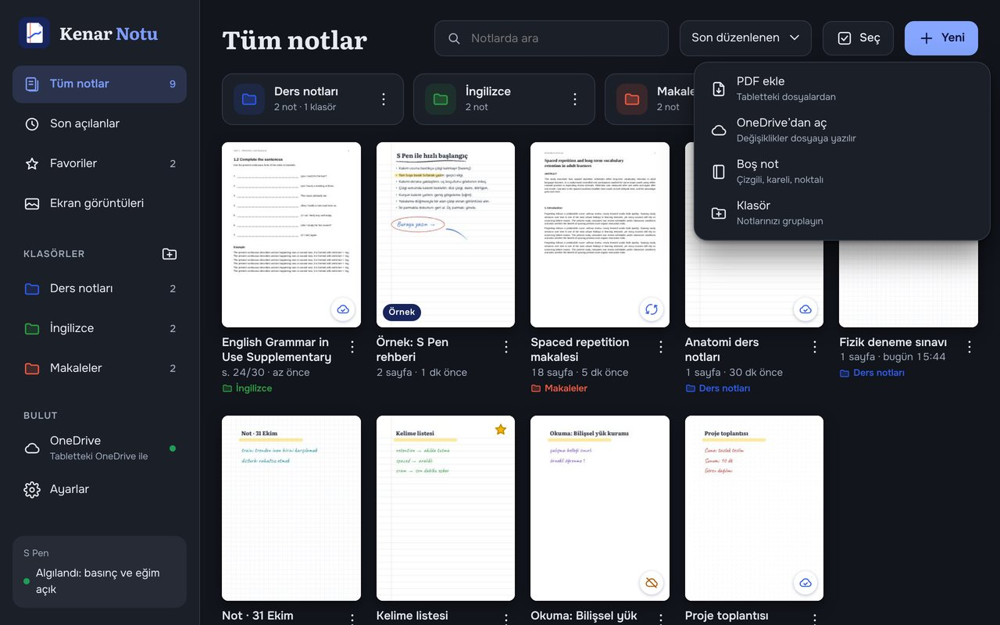
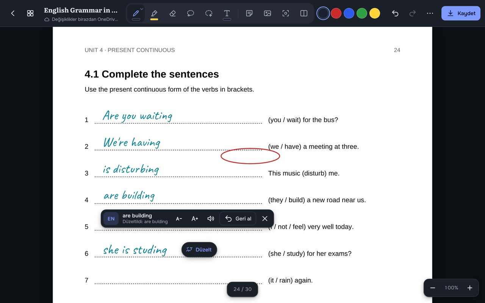
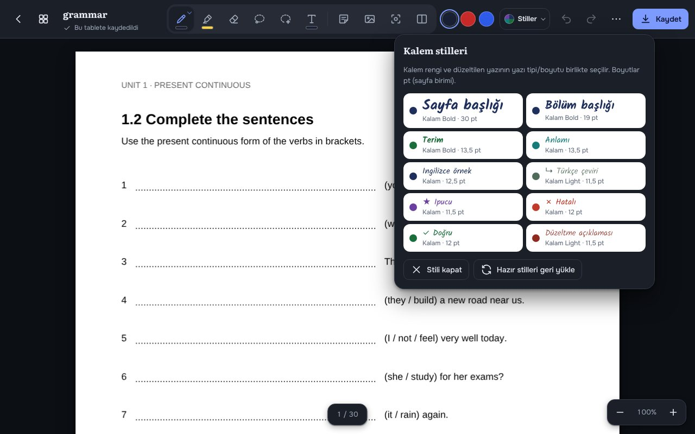
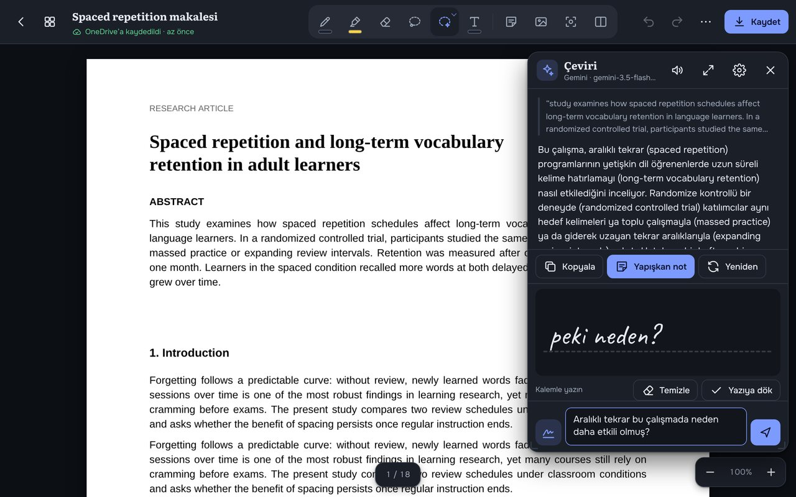
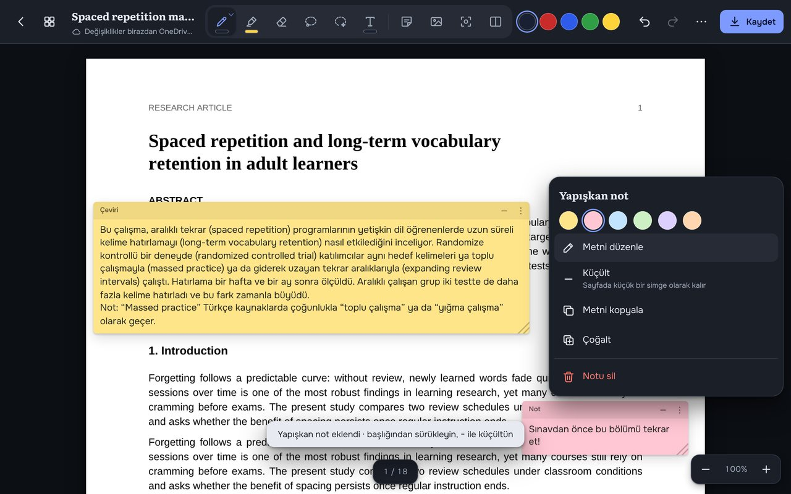
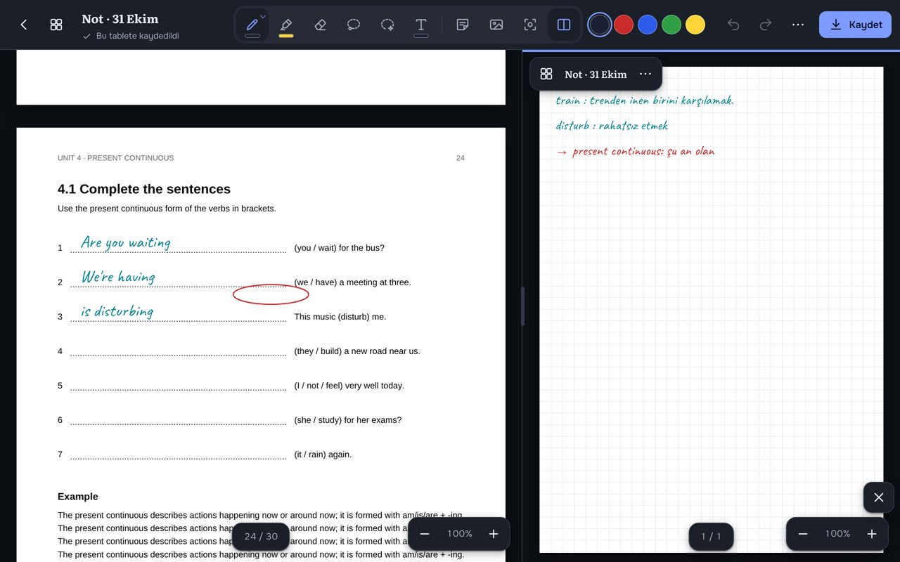
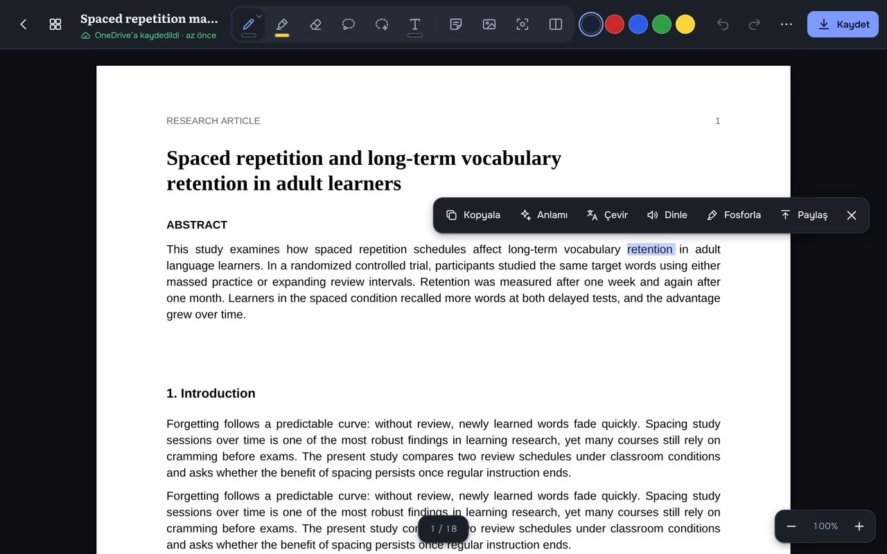
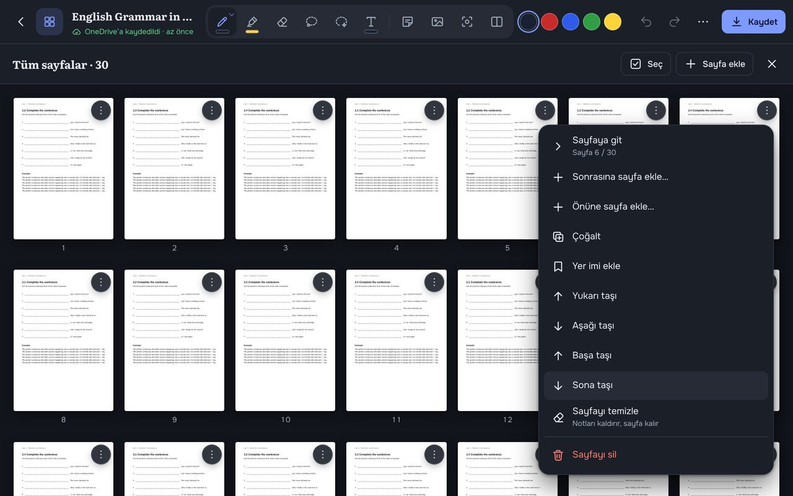
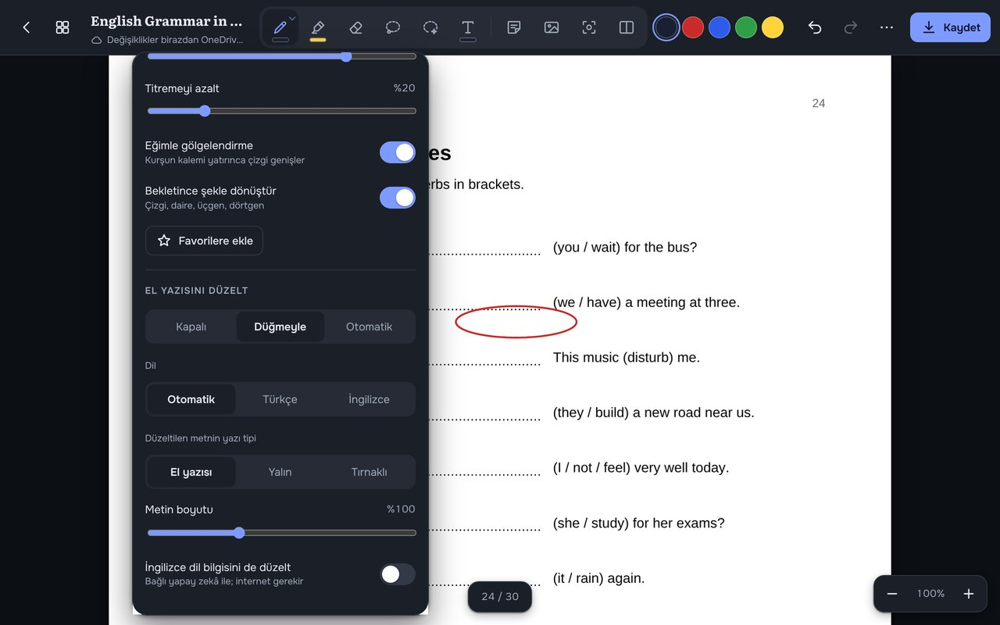

# Kenar Notu

Samsung Galaxy Tab S11 tabletimde her gün kullandığım, S Pen ile PDF'lerin kenarına not aldığım uygulama.
PDF'i açıyorum, üzerine kalemle yazıyorum; el yazımı düzgün metne çevirip düzeltiyor, bilmediğim kelimeyi
basılı tutunca İngiliz aksanıyla okuyor, seçtiğim paragrafı açıklıyor ya da çeviriyor ve notlu PDF'i
OneDrive'daki aynı dosyaya geri kaydediyor. Böylece bilgisayarda da aynı notları görüyorum.

Uygulama bir web uygulaması (PWA) ve onu saran küçük bir Android kabuğundan oluşuyor. Tablette APK olarak kurulu.



---

## Ne için kullanıyorum

- **Makale okumak.** Akademik makaleleri tablette okuyorum. Bir paragrafın etrafını kalemle çevirip
  "Açıkla" ya da "Çevir" diyorum; yanıtı o paragrafın üzerine yapışkan not olarak yapıştırıyorum.
  Önemli İngilizce terimler çeviride parantez içinde kalıyor, böylece kaynaktaki kavramı kaybetmiyorum.
- **İngilizce çalışmak.** *English Grammar in Use* ve *English Vocabulary in Use* alıştırmalarını PDF'in
  üzerinde S Pen ile çözüyorum. Yazdığım cevaplar düzgün metne dönüşüyor ve yazım hataları düzeltiliyor.
  Bilmediğim kelimeye basılı tutunca İngiliz kadın sesiyle telaffuzunu dinliyorum, sözlük penceresinde anlamına bakıyorum.
- **Kelime ve ders notu tutmak.** Hazır kalem stilleriyle (Terim · Anlamı · İngilizce örnek · Türkçe çeviri ·
  İpucu · Hatalı/Doğru) her not aynı düzende ve renklerde oluyor.
- **Kitap ile defteri yan yana açmak.** Solda PDF, sağda boş kareli sayfa; tek araç çubuğu iki tarafta da çalışıyor.
- **Ekrandan parça almak.** Bir tablonun ya da şeklin ekran görüntüsünü alıp not sayfama yapıştırıyorum.
- **Bilgisayarla eşitlemek.** Dosyalar OneDrive'da; tablette notladığım PDF bilgisayarımdaki aynı dosyada güncelleniyor.

---

## Ekran görüntüleri

| El yazısını düzelt | Kalem stilleri |
|---|---|
|  |  |
| **Yapay zekâ ile çeviri ve kalemle soru** | **Yapışkan not** |
|  |  |
| **Yan yana belge** | **Basılı tutunca sesli okuma** |
|  |  |
| **Tüm sayfalar** | **El yazısı ayarları** |
|  |  |

---

## Özellikler

**S Pen ile yazma**
- Basınç ve eğim duyarlı dolma, tükenmez, kurşun, kaligrafi, fırça ve fosforlu kalem.
- Yan tuşla geçici silgi, havada imleç, avuç içi reddi, titremeyi azaltma.
- Bekletince şekle dönüştürme (çizgi, daire, üçgen, dörtgen).
- **Karalayarak sil:** yazının üzerini zikzakla karalayınca altındaki yazı silinir.
- Kement ile seç, taşı, büyüt/küçült, döndür, rengini değiştir. Metne ya da görsele basılı tutunca da seçilir.

**El yazısını düzelt**
- Yazdığın satır metne çevrilir ve yazım hataları düzeltilir. Türkçe ve İngilizce karışık yazılabilir.
- Android'de tamamen cihazda çalışır (Google ML Kit el yazısı tanıma + Samsung Klavye'nin yazım denetleyicisi).
  Web'de bağlı yapay zekâ ile çalışır.
- Kapalı / Düğmeyle / Otomatik modları; TR/EN düğmesiyle diğer dilde yeniden okuma; A− / A+; Geri al.
- Daha önce yazılanlar için: kement ile seç → "Yazıya dök".

**Kalem stilleri**
| Stil | Renk | Yazı tipi |
|---|---|---|
| Sayfa başlığı / Bölüm başlığı | Lacivert `#1F2F5C` | Kalam Bold 30 / 19 pt |
| Terim | Yeşil `#1B6E3C` | Kalam Bold 13,5 pt |
| Anlamı | Turkuaz `#167A7A` | Kalam 13,5 pt |
| İngilizce örnek | Koyu mavi `#1F2F5C` | Kalam 12,5 pt |
| ↳ Türkçe çeviri | Gri-yeşil `#4F6B5A` | Kalam Light 11,5 pt |
| ★ İpucu | Mor `#6B3FA0` | Kalam 11,5 pt |
| ✗ Hatalı / ✓ Doğru | Kırmızı `#C0392B` / Yeşil `#1B6E3C` | Kalam 12 pt |
| Düzeltme açıklaması | Koyu kırmızı `#8E2A20` | Kalam Light 11,5 pt |

Stil seçilince kalem o renge geçer, düzeltilen yazı o yazı tipi ve boyutla yazılır. Sayfa birimi PDF noktası
olduğu için (A4 = 595 × 842 pt) boyutlar birebir aynıdır.

**Okuma ve yapay zekâ**
- PDF metninde kelimeye basılı tut: seç, kopyala, fosforla, paylaş, **Dinle**, **Anlamı**, **Çevir**.
- **Alanı çevrele:** bir paragrafın ya da tablonun etrafını çiz → Açıkla / Çevir / Not yapıştır.
  Taranmış sayfalarda alanın görüntüsü gönderilir.
- Sözlük ve sohbet penceresi: taşınabilir, boyutlandırılabilir; kalemle soru yazılabilir.
- Gemini (ücretsiz katman) ya da Claude. API anahtarı yalnızca tablette saklanır.
- Sesli okuma: Android metin okuma motoru, varsayılan İngiliz İngilizcesi kadın sesi; hız ve ses seçilebilir.

**Belge ve sayfalar**
- Sayfa paneli (küçük resimler, içindekiler, yer imleri, belgede arama), tüm sayfalar ızgarası,
  sürükleyerek sıralama, sayfa ekleme/çoğaltma/silme.
- Yapışkan notlar, metin kutuları, görsel ekleme, bölge ekran görüntüsü.
- Kitaplıkta klasörler, favoriler, son açılanlar, çoklu seçim.
- Yan yana iki belge; açık/koyu tema; okuma modu; PDF renklerini ters çevirme.
- Şifreli (düzenleme kısıtlı) ya da hasarlı PDF'ler kaydederken onarılır (qpdf).

**OneDrive**
- Android'de: dosya OneDrive uygulaması üzerinden açılır, notlu PDF aynı dosyaya yazılır. Microsoft kaydı gerekmez.
- Çakışma koruması; OneDrive önceki yüklemeyi bitirmeden aynı dosyaya yeniden yazılmaz
  (bu, OneDrive'ın "Dosya 1.pdf" gibi kopyalar oluşturmasını önler); değişmeyen not yeniden yüklenmez.
- Web'de: Microsoft Graph ile bağlanılır (bkz. [web ve OneDrive kurulumu](docs/web-ve-onedrive-kurulumu.md)).

---

## Yapı

```
index.html, sw.js, manifest.webmanifest, config.js   Web uygulaması (derleme adımı yok)
css/                 Stiller, yazı tipi tanımları
js/                  Uygulama kodu
  util.js            Ayarlar, simgeler, ortak bileşenler
  ink.js             Kalem dinamiği, çizim, metin kutuları
  editor.js          Düzenleyici: araçlar, seçim, silgi, karalayarak silme
  pages.js           Sayfa paneli, tüm sayfalar, arama
  pdfio.js           PDF okuma ve notlu PDF üretme (pdf-lib, qpdf)
  hand.js            El yazısını düzelt
  speak.js           Sesli okuma
  ai.js              Sözlük, çeviri, sohbet (Gemini / Claude)
  sticky.js          Yapışkan notlar, alanı çevrele
  textsel.js         PDF metni seçme
  split.js           Yan yana belge
  onedrive.js        OneDrive (Graph) ve eşitleme
  native.js          Android köprüsü (dosyaya yazma, paylaşma, OneDrive SAF)
fonts/               Onest, Literata, Caveat, Kalam (çevrimdışı)
vendor/              PDF.js, pdf-lib, MSAL, qpdf (wasm)
android-uygulama/    Android kabuğu (WebView)
  app/src/main/java/com/kenarnotu/app/
    MainActivity.java          WebView, KenarNative köprüsü, OneDrive'a yazma
    HandwritingCorrector.java  ML Kit el yazısı tanıma + yazım düzeltme
    Speaker.java               Metin okuma (en-GB kadın sesi)
  APK-OLUSTUR.bat              Windows'ta tek tıkla APK
  KURULUM.txt                  Kurulum ve sürüm notları
docs/                Ekran görüntüleri, web ve OneDrive kurulumu
```

Android kabuğu web uygulamasını paketin içinden `https://localhost/` adresiyle sunar; S Pen olayları doğrudan
sayfaya gelir. Sayfa, kabuğa `window.KenarNative` üzerinden ulaşır.

---

## Kurulum

### Android (Galaxy Tab)

1. Windows'ta `android-uygulama/APK-OLUSTUR.bat` dosyasını çift tıklayın. Java ve Android SDK yoksa kendisi indirir,
   web dosyaları eksikse üst klasörden uygulamaya kopyalar ve APK'yı oluşturur.
2. APK'yı tablete kopyalayıp kurun. Ayrıntılar: [`android-uygulama/KURULUM.txt`](android-uygulama/KURULUM.txt).

> İmzalama anahtarı (`kenar-notu.keystore`, `keystore.properties`) depoda **yoktur**. Kendi anahtarınızla derlemek için
> `android-uygulama/` içine bir keystore ve `storeFile`, `storePassword`, `keyAlias`, `keyPassword` alanlarını içeren
> `keystore.properties` dosyası koyun.

### Web (PWA)

Klasörü herhangi bir statik sunucuyla yayınlayın (`python -m http.server 8080`), tablette tarayıcıdan açıp
"Ana ekrana ekle"yi seçin. HTTPS ve OneDrive kaydı için: [web ve OneDrive kurulumu](docs/web-ve-onedrive-kurulumu.md).

### Yapay zekâ

Sözlük penceresi → ⚙ → Gemini (aistudio.google.com → "Get API key") ya da Claude anahtarı. Anahtar yalnızca
cihazda saklanır, depoya girmez.

---

## Gizlilik

Notlar tabletin kendi deposunda tutulur. Dosyalar yalnızca seçtiğiniz OneDrive dosyasına yazılır. Yapay zekâ
özellikleri yalnızca siz kullandığınızda seçilen metni ya da alanı seçtiğiniz sağlayıcıya gönderir. El yazısı tanıma
ve sesli okuma Android'de cihazda çalışır.

## Bilinen sınırlar

- S Pen'in Air Actions hareketleri desteklenmez.
- Parola ile açılan (açılış şifreli) PDF'ler açılmaz.
- Kurşun kalemin doku görünümü dışa aktarılan PDF'te düz gri çıkar.

## Lisanslar (üçüncü taraf)

- PDF.js — Apache 2.0 (Mozilla) · pdf-lib — MIT · MSAL.js — MIT (Microsoft) · qpdf — Apache 2.0
- Google ML Kit Digital Ink Recognition — Google API Hizmet Şartları
- Onest, Literata, Caveat, Kalam yazı tipleri — SIL Open Font License 1.1

---

Kişisel kullanım için geliştirildi; Claude (Anthropic) ile birlikte yazıldı.
